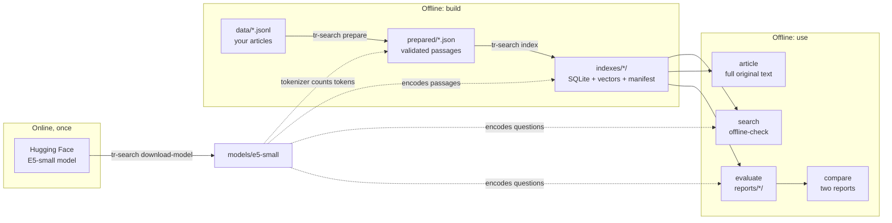
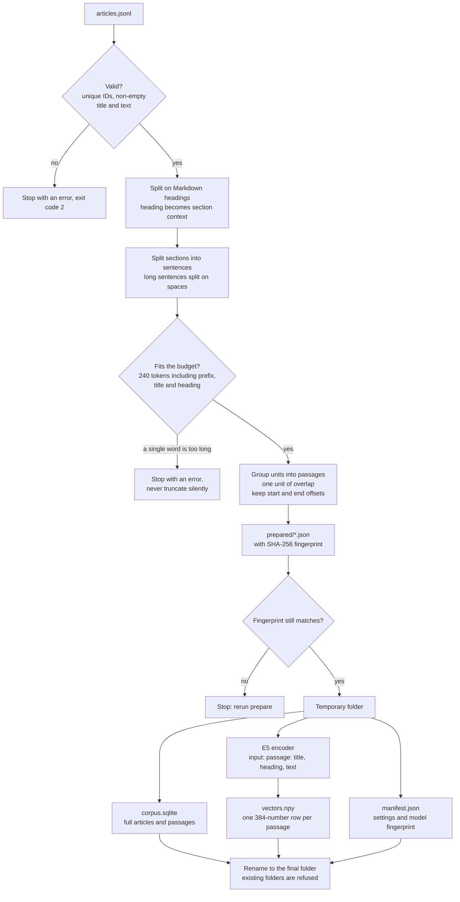
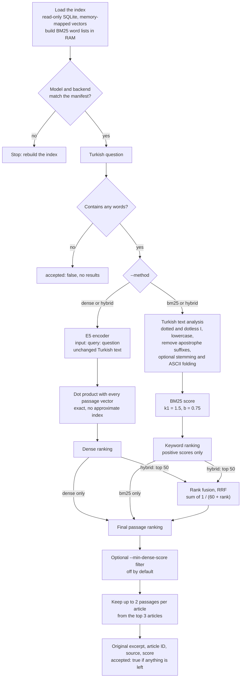
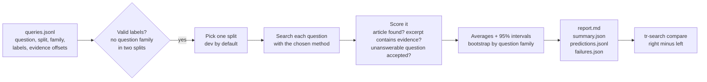

# Turkish Offline Search

A standalone experimental Turkish article search engine. It retrieves original excerpts and full articles; it never generates an answer. Everything after dependency/model installation runs locally. Python 3.10+; start on a laptop, measure before deploying to a phone.

**Status:** working research prototype, not an emergency product. The included collection describes fictional library/account services. Its 26 AI-authored questions (20 dev, 6 test) are transparent smoke-test fixtures, **not a human-validated accuracy benchmark**. The [Survival TR release requirements](docs/safety-policy.md#release-requirements) still apply to any future emergency use.

## Quick start on macOS / Linux

From the root of this repository:

```bash
python3 -m venv .venv
source .venv/bin/activate
python -m pip install -c constraints-tested.txt -e '.[semantic,dev]'

# ONLINE once: download E5-small (~hundreds of MB, plus runtime dependencies).
tr-search download-model --output models/e5-small

# OFFLINE from here: clean, token-aware passages; exact vectors + BM25.
tr-search prepare --articles data/demo/articles.jsonl --output prepared/demo.json --model models/e5-small
tr-search index --prepared prepared/demo.json --output indexes/demo --model models/e5-small --stem --ascii-fold
tr-search search --index indexes/demo --model models/e5-small 'Parolamı hatırlamıyorum nasıl yenilerim?'
tr-search search --index indexes/demo --method hybrid --model models/e5-small 'kutuphane pazar acik mi'

# Read the original article entirely from SQLite.
tr-search article --index indexes/demo password-reset

# A fresh process blocks Python socket connections/DNS BEFORE loading the model.
tr-search offline-check --index indexes/demo --model models/e5-small 'Notlarımı internetsiz nasıl okuyabilirim?' --json
```

Also repeat with Wi-Fi disconnected. The Python socket guard is a diagnostic, **not an OS-level network sandbox** and cannot intercept networking from every native library. The local-only loaders and offline environment flags prevent intentional Hub calls. No API keys or servers required. Model download is the only deliberately network-enabled model command. On some proxied development machines, installing `socksio` may be necessary for downloads.

Commands refuse to overwrite existing model, index, prepared-data, or report destinations. Use a new path per experiment. Return code 2 indicates invalid input/configuration; search with no results returns 0 with `accepted: false` in JSON.

### Try the lightweight keyword baseline first

No model, Torch, or internet is needed after installing core dependencies:

```bash
python -m pip install -e '.[dev]'
tr-search prepare --lexical-only --articles data/demo/articles.jsonl --output prepared/lexical.json
tr-search index --lexical-only --prepared prepared/lexical.json --output indexes/lexical --stem --ascii-fold
tr-search search --index indexes/lexical --method bm25 'kütüphane üyeliği'
```

`--lexical-only` preparation counts regex word/punctuation units, **not E5 tokens**. For fair model comparisons use the same model-tokenized prepared file for dense and BM25 indexes. BM25 is implemented locally with positive IDF, `k1=1.5`, `b=0.75`, no stopword removal, optional Snowball Turkish stemming, optional Turkish ASCII folding. Exact-name apostrophe suffixes are removed in the lexical branch. Stemmed/folded text is never sent to E5.

## Latest test results

Measured on 2026-11-01 with E5-small and hybrid search, on 39 real Turkish articles from AFAD, Türk Kızılayı, AKUT, TTB, the Turkish Psychiatric Association and a WHO-based guide, split into 386 passages, plus 343 example questions (662 with versions lacking Turkish letters).

**These results can't be reproduced from this repository.** The articles and example questions stay on the author's machine because their reuse rights are unconfirmed. One AI wrote the questions and judged the results, and no Turkish speaker or medical expert has reviewed them, so real users may do worse. See the [first evaluation](docs/real-source-evaluation-2026-11.md) for the earlier baseline.

### Accuracy on held-out questions

Each question set was locked before the run. Ranges are 95% bootstrap intervals.

| Measure | 44 questions, no example questions | 44 questions, with example questions | 40 questions, with example questions |
|---|---|---|---:|
| Labeled answer on screen (3 articles, up to 2 passages each) | 59% (26) | **89% (39)** [77–98] | **98% (39)** [90–100] |
| Right article ranked first | 57% (25) | 84% (37) [73–93] | 95% (38) [88–100] |
| Right article in top 3 | 80% (35) | 98% (43) [91–100] | 100% (40) |
| Labeled answer in first excerpt | 27% (12) | 66% (29) [52–80] | 80% (32) [68–93] |
| Unanswerable questions that still get a result | 10 of 10 | 10 of 10 | 30 of 30 |

The same author wrote the example questions and both sets, and wrote the 40-question set after the example questions existed, so the third column is the most likely to flatter. On casual wording in the 44-question set, answers on screen rose from 2 to 10 of 13.

Search always returns results for real questions, so it also answers when the articles have nothing on the topic. For example, "Doğum başladı" returns earthquake advice. Don't treat a result as proof that the answer is relevant.

### Coverage of emergency questions

105 questions were written from emergency needs rather than from the articles, then judged by reading the results. The "after" column was judged just before the last 6 example questions were added.

| Measure | First evaluation | After cleaning, new sources and example questions |
|---|---|---|
| Direct answer exists | 48 | 58 |
| Only partial guidance | 27 | 28 |
| Nothing usable | 30 | 19 |
| Direct answers shown on screen | 32 of 48 | 54 of 58 |

Life-threatening topics with nothing usable: thirst under rubble, giving water to someone just rescued, lifting weight off a crushed limb, stroke, bleeding in pregnancy, childbirth, keeping a newborn warm, generators and self-harm.

### Small local models

| Model | Use | Answer on screen (44 questions) | Result |
|---|---|---:|---|
| Example questions only | Baseline | 39 | Kept |
| Qwen 0.5B | Rewording questions | 34 | Rejected: it also changed meanings, such as "100 gram parasetamol" |
| Qwen 0.5B, original and reworded question | Matching | 40 | Rejected: within noise and about 1.7 s per question on the test Mac |
| modernbert-tr-reranker | Re-sorting results | 33 | Not adopted: it ignores the example questions |
| mMiniLMv2 reranker | Re-sorting results | 29 | Not adopted |

Without example questions, modernbert-tr-reranker raised answers on screen from 26 to 30. Rewriting and rerankers ran at full precision, so their speed isn't a phone figure.

### Speed and size

Measured on an Apple M1 Mac with two threads and PyTorch. No phone has been tested.

| Measure | Result |
|---|---:|
| Warm search, P50 / P95 | 18 / 32 ms |
| Cold start, one search | 6.2 s |
| Peak memory footprint | 591 MB |
| Index | 2.5 MB |
| Model, full precision | 466 MB |

### Automated tests

`pytest -q`: 17 passed, 1 skipped. The skipped test needs a local model. These tests check behavior, not search accuracy.

## Evaluate and compare

Use the same index and questions to isolate the retrieval-method change:

```bash
tr-search evaluate --index indexes/demo --model models/e5-small --method dense --queries data/demo/queries.jsonl --output reports/dense
tr-search evaluate --index indexes/demo --method bm25 --queries data/demo/queries.jsonl --output reports/bm25
tr-search evaluate --index indexes/demo --model models/e5-small --method hybrid --queries data/demo/queries.jsonl --output reports/hybrid
tr-search compare reports/dense reports/hybrid
```

Each report contains:

- `report.md`: readable metrics and family-cluster bootstrap intervals.
- `summary.json`: configuration, package versions, fingerprints, warm latency and index bytes.
- `predictions.jsonl`: every question and ranked article/passage result.
- `failures.json`: first-article misses and false accepts on unanswerable questions.

Main metrics: distinct-article Success@1/@3, Recall@3 (grade 2), MRR@10, graded nDCG@10; evidence-containing excerpt Success@1 and candidate Success@20; false acceptance/rejection rates. Reported success means matching labels, not independent factual verification. Unjudged articles count as 0; pool and review candidates to make labels sufficiently complete. Queries with no evidence spans are excluded from evidence metrics, not counted as successes or failures.

Read [the evaluation guide](docs/evaluation.md) before interpreting scores or tuning on a final test set.

## Bring your own Turkish articles

Create UTF-8 JSONL: one JSON object per line. IDs must be unique. Preserve text exactly once you label evidence.

```json
{"article_id":"my-article","title":"Başlık","source":"Source URL or citation","version":"1","text":"# Bölüm\nMakalenin özgün metni..."}
```

The prototype accepts text/Markdown inside JSONL; it does not crawl websites, parse PDFs, or collect official emergency guidance. Clean extraction separately. Markdown headings set section context. Passages retain their parent article ID and exact character offsets into original text. Defaults are 240 model tokens including `passage:`, title, heading, and special tokens; overlap is one sentence/word unit. Long sentences split on whitespace. An unbreakable over-budget word or over-budget heading raises an error instead of truncating silently.

For a different experiment:

```bash
tr-search prepare --articles data/my-articles.jsonl --output prepared/my-320.json --budget 320 --overlap 1
tr-search index --prepared prepared/my-320.json --output indexes/my-320 --stem
```

## INT8 ONNX experiment

Install conversion dependencies while online, then export from the local FP32 bundle:

```bash
python -m pip install -c constraints-tested.txt -e '.[onnx]'
tr-search quantize --source models/e5-small --output models/e5-int8 --config arm64
```

Use `arm64` for an Apple Silicon CPU; use a suitable `avx2`/`avx512` configuration for an x86 CPU. This is CPU inference. E5 uses two Torch threads by default; override with `TR_SEARCH_THREADS=4` and record the setting when benchmarking. Speedups and accuracy depend on hardware; compare against FP32. The exporter prints relative ONNX filenames; use its exact output (some configurations use `quint8` rather than `qint8`). For an export reported as `onnx/model_qint8_arm64.onnx`, pass that complete relative path as `--onnx-file onnx/model_qint8_arm64.onnx`:

```bash
tr-search index --prepared prepared/demo.json --output indexes/demo-int8 --model models/e5-int8 --backend onnx --onnx-file onnx/model_qint8_arm64.onnx --stem --ascii-fold
tr-search evaluate --index indexes/demo-int8 --model models/e5-int8 --backend onnx --onnx-file onnx/model_qint8_arm64.onnx --queries data/demo/queries.jsonl --output reports/int8
tr-search compare reports/dense reports/int8
```

The quantized bundle omits FP32 weights; conversion runs in a temporary copy so the source bundle is unchanged. Quantized and FP32 encoders get separate passage vectors; an index rejects a different model/backend/file. Keep complete model directories available offline. Do not assume the model bundle size equals RAM or total installed package size.

## Architecture

The project has one job: find the original article text that best matches a Turkish question. No model writes or rewrites text, so what you read is always the source wording. [docs/architecture.md](docs/architecture.md) defines the terms used below.

### The big picture

The network is used only to install packages and download the model. Everything after that runs locally, from four kinds of files on disk.



Dotted lines are skipped in keyword-only (`--lexical-only` / `--method bm25`) mode, which needs no model at all.

### Building an index

`prepare` splits articles without changing them, so every passage can be traced to exact character positions in the original. `index` then writes everything to a temporary folder and renames it into place only if all steps succeed, so a failed build never leaves a half-finished index.



### Answering a search

Dense search matches meaning, BM25 matches words, and hybrid combines their rankings. Results then show the top articles with up to two passages each, because an article's best-scoring passage can be the wrong section.



For example, `kutuphane pazar acik mi` is typed without Turkish letters. In the demo evaluation, dense ranks the correct article 7th and BM25 ranks it 1st, so hybrid also ranks it 1st. The reverse happens too: `Odayı kaç saat ayırtabilirim?` is 3rd in BM25 and 1st in dense and hybrid.

`accepted: true` only means a result survived. It does not mean the answer is correct, and without a calibrated cutoff, dense and hybrid search return something even for unanswerable questions.

### Measuring quality

`evaluate` scores a set of labeled questions and saves every prediction. `compare` then checks two reports question by question, and refuses if they used different questions or articles.



### Where the code lives

| File | Responsibility |
|---|---|
| `src/turkish_search/cli.py` | The `tr-search` commands, and the socket block used by `offline-check` |
| `src/turkish_search/data.py` | Reading and validating articles, passage splitting, fingerprints |
| `src/turkish_search/text.py` | Turkish text analysis, used for BM25 only |
| `src/turkish_search/encoder.py` | Loading local models, downloading, INT8 export, `query:`/`passage:` prefixes |
| `src/turkish_search/search.py` | Index writing, BM25, rank fusion, the `Searcher` |
| `src/turkish_search/evaluation.py` | Label validation, metrics, reports, comparison |
| `tests/` | `test_core.py` needs no model; `test_semantic.py` runs when `TR_SEARCH_MODEL` is set |
| `data/demo/` | 12 fictional articles and 26 AI-written questions |
| `docs/` | Glossary, evaluation guide, validation status, safety policy, decision records |

### Design details and limitations

- E5-small: 384-dimensional normalized vectors, explicit `query:`/`passage:` roles.
- SQLite contains full articles and passages; a NumPy `.npy` matrix contains exact-search FP32 vectors. No pickle deserialization or hosted vector database.
- Dense search compares against every passage. Hybrid combines the top 50 dense/BM25 passage lists with RRF (`k=60`), then selects each distinct article's highest-ranked passage. The candidate cutoff affects hybrid recall.
- `--min-dense-score` optionally filters dense/hybrid candidates by raw cosine score. No default cutoff: scores are not probabilities. BM25 accepts any positive lexical match. Dense without a cutoff normally accepts something even for an unanswerable question.
- No reranker, ANN index, training pipeline, mobile UI, web server, or production confidence model in v0.1. Add complexity only after failure analysis.
- `summary.json` includes index size, not complete installed-runtime size or peak RAM. Searcher load time excludes encoder initialization. Measure complete fresh-process startup and peak memory separately (see docs).

See [architecture and glossary](docs/architecture.md), [evaluation and optimization](docs/evaluation.md), and [validation status](docs/validation.md).

## Project history

This repository began as Survival TR, an offline emergency assistant. The earlier Kumru writer experiment [failed](docs/decisions/001-phase1-kumru-writer.md), so this project retrieves original text instead of generating it. The removed experiment code remains in git history at commit `f0e4dab`.

## Development

```bash
python -m pip install -e '.[dev]'
pytest -q
```

Core tests require no model download. Semantic integration is separately exercised when a local E5 bundle exists; see `tests/test_semantic.py`. CI runs deterministic core tests and the BM25 CLI/eval path without downloading model weights.

## Research and documentation

- [E5 technical report](https://arxiv.org/abs/2402.05672) and [E5-small model card](https://huggingface.co/intfloat/multilingual-e5-small)
- [TR-MTEB (EMNLP 2025)](https://aclanthology.org/2025.findings-emnlp.471/)
- [TR-TEB (LREC 2026)](https://aclanthology.org/2026.lrec-1.862/)
- [TurkColBERT](https://arxiv.org/abs/2511.16528)
- [Sentence Transformers efficiency / quantization](https://sbert.net/docs/sentence_transformer/usage/efficiency.html)

MIT for this prototype. External article and model licenses remain their owners' responsibility. Demo articles and labels are synthetic and included under this project's MIT license.
