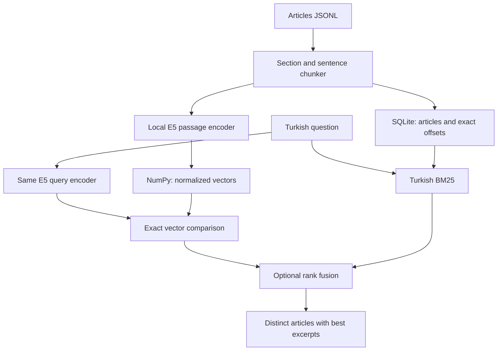

# Architecture from the ground up

## The two jobs

**Indexing** prepares your bookshelf: read original articles, identify sections, create small passages, encode those passages once, save them. **Search** interprets a new question, compares it to the saved representations, and returns the original source text. No answer-writing model exists in this project.

## Terms, with concrete meaning

| Term | Meaning here |
|---|---|
| Corpus | All searchable articles, including distractors |
| Query | What the user types |
| Chunk / passage | A contiguous original text span with parent article and offsets |
| Tokenizer | Converts text into model-recognized pieces and their IDs |
| Token | A word piece or punctuation; Turkish words can use several |
| Encoder | A network that turns text into a numerical representation |
| Parameter | A learned weight inside the network |
| Embedding / vector | The resulting list of 384 numbers |
| Pooling | Combining token representations into one passage representation |
| Normalization | Scaling the vector so its length is one |
| Dot product | Sum of corresponding number products; equals cosine for normalized vectors |
| Cosine similarity | Directional vector alignment, used as a ranking signal |
| Inference | Executing fixed learned weights |
| Index | Saved corpus plus representations used for search |
| BM25 | Word-match scoring with rare-term emphasis and length normalization |
| Stemming | Reducing suffix variants toward a common form |
| ASCII folding | Mapping Turkish characters to approximate ASCII equivalents in the lexical branch |
| RRF | Reciprocal rank fusion; sums `1/(60+rank)` across the two lists |
| Candidate | A passage considered before presenting the final articles |
| Deduplication | Return each article once, using its best-ranked passage |
| Quantization | Storing model numbers in fewer bits, such as INT8 |
| ONNX / runtime | Portable model format / the software that executes it |
| ANN | Approximate nearest-neighbor search; not used here |
| Reranker | A second model jointly scoring each query/candidate pair; not used here |
| Fingerprint | SHA-256 digest identifying exact content/configuration |

## Why exact search and a small model first?

Ten thousand passages × 384 dimensions × four bytes = 15.36 MB for raw vectors. That is a straightforward matrix; compare all rows before introducing ANN recall errors. E5-small has roughly 118M parameters: arithmetic weight-only storage is ~472 MB FP32 or ~118 MB if every weight were INT8. Actual exports, runtime libraries, temporary activations, corpus text, and index structures add costs. It is not a 118 MB application-size guarantee.

E5 was retrieval-trained. An unadapted Turkish BERT model is not interchangeable with a retrieval encoder. A Turkish question and answering passage need compatible vectors even when their words differ.

## Files and invariants

`prepare` stores articles, chunks, configuration and a content fingerprint in JSON. Chunk text must equal `article.text[start:end]`; token counts include role prefix, title and heading. No silent input truncation is allowed by the encoder.

`index` validates the prepared fingerprint, creates a temporary directory, writes SQLite/vectors/manifest, then renames the directory into place. Existing destinations are refused. The manifest identifies the exact model bundle, backend and ONNX filename. Changing those requires a new index. Stored matrices never use pickled Python objects.

`search` opens SQLite read-only, loads vectors with a memory map, and builds a lightweight in-memory BM25 posting list. The encoder is loaded once per process. Queries reuse it during evaluation. The CLI starts a fresh process per invocation, so its startup overhead differs from warm in-process query latency.

Hybrid RRF operates on passages before grouping by article; long articles can have more opportunities to match. Evaluate that bias. Best-passage aggregation is deliberately simple; it is not a guarantee that the complete article is correct or current.

## Offline boundary

Dependencies and model weights are obtained beforehand. Runtime loaders require local paths, set Hub offline flags and use `local_files_only=True`. Original full articles are stored in SQLite, so displaying one does not follow a source URL. `offline-check` blocks Python socket connect/DNS before model loading. An actual disconnected-device or OS network-denial test remains necessary for a production bundle.
